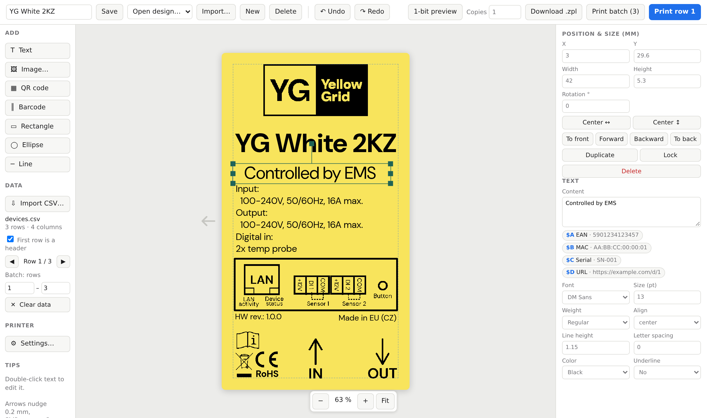

# Open ZPL Designer

A small local web app for designing product labels and printing them on a **GoDEX G530** thermal printer over the network.

You lay the label out in the browser in a drag-and-drop editor, a little like Canva. Add text, images (PNG, JPG, SVG and so on), QR codes, barcodes (EAN-13, Code 128) and simple shapes, then move, resize and rotate them with the mouse. Designs are saved by name and can be reopened later. **Print** (or Ctrl+P) sends the label straight to the printer. For series of devices, **batch printing** fills placeholders like `$A`, `$B` from a CSV file and prints one label per row. **1-bit preview** shows exactly which dots the printer will get.

The app is set up for 90 × 50 mm label stock, designed in portrait (50 mm wide, 90 mm tall), with the company font DM Sans built in. Label size, orientation and the printer are changed in **Settings**.



## How it works

```
browser editor  ──PNG──▶  Flask server  ──ZPL over TCP 9100──▶  GoDEX G530
(Fabric.js, 1 px = 1 dot)  (rotate, offsets, 1-bit)            (prints one bitmap)
```

1. **The browser draws the whole label.** The editor canvas is exactly the size of the label in printer dots (300 dpi, so 591 × 1063 px). Fonts, Czech diacritics, images, QR codes and barcodes are all drawn there, so what you see is what prints. Images are turned into black and white in the editor: *threshold* mode suits logos and line art, *dither* mode suits photos and gradients.
2. **On Print, the browser sends the finished label as one PNG** to the local server (`app.py`). A batch sends one PNG per CSV row, ten per request.
3. **The server turns it into ZPL** (`label.py`). It rotates the design (portrait or landscape) to the way the stock runs through the printer, applies the calibration offsets from `config.toml`, and makes it strictly 1-bit. The whole label then becomes a single ZPL graphic field (`^GFA`).
4. **The ZPL job goes to the printer's raw port 9100.** It uses only basic commands (`^XA ^PW ^LL ^LH ^FO ^GFA ^PQ ^XZ`), which the G530's ZPL emulation handles reliably. The job is exactly as wide as the label, and the printer centres it on the label itself.

Because the printer only ever receives a finished bitmap, nothing depends on its built-in fonts, code pages or barcode support.

## Setup: from cloning to the first print

### 1. What you need

- A computer on the same network as the printer, running Linux, macOS or Windows.
- [uv](https://docs.astral.sh/uv/getting-started/installation/), the Python package manager. It installs the right Python (3.12+) and the dependencies (Flask, Pillow, qrcode, python-barcode) by itself.
- A current browser. It's tested in Chromium/Chrome; Firefox should work too.
- The GoDEX G530 connected by Ethernet, with 90 × 50 mm labels loaded.

### 2. Get the code and start the app

```sh
git clone https://github.com/Huml-YG/Open-ZPL-Designer.git
cd Open-ZPL-Designer
uv run app.py
```

**On NixOS,** run `nix-shell` first, and then `uv run app.py` inside it. `shell.nix` provides uv plus the system libraries that Pillow needs.

Open <http://127.0.0.1:5000>. The editor should appear with an empty label. The first `uv run` downloads the dependencies, which takes a moment.

### 3. Prepare the printer

1. **Find its IP address.** It's on the printer's configuration printout or self-test page, or in GoDEX's NetSetting tool. A fixed address, or a DHCP reservation, saves trouble later.
2. **Make sure it accepts ZPL.** In GoDEX GoLabel or NetSetting, set the command language (emulation) to **Auto** or **ZPL**. If labels come out with ZPL code printed as text, or nothing prints at all, this is the cause.
3. **Run media calibration** after loading the label roll, using the printer's feed button or GoLabel. This lets the printer find the gaps between labels. Skip it and the printer may feed several labels per job or stop in the middle of one.

### 4. Point the app at the printer

Click **⚙ Settings…** (left panel, *Printer*). Everything below can be set there, without editing files.

- **Printer.** Enter the printer's address, then click **Test connection** to check it can be reached on port 9100. Resolution is 300 dpi for the G530. Darkness and speed can stay empty, which keeps the printer's own settings.
- **Label.**
  - *Width across the print head* and *Length in feed direction* are the size of the stock as it runs through the printer: 90 and 50 mm for the stock this was set up with.
  - *Design orientation* chooses whether you design in portrait or landscape. The summary line shows the resulting canvas size.
  - Tick **Print rotated 180°** if labels come out upside down.

**Save** writes everything to `config.toml`, keeping its comments, and reloads the editor. Your current design and CSV data stay. You can still edit `config.toml` by hand if you prefer; it's re-read on every request.

### 5. Calibrate the position

Every printer and roll sits slightly differently, so the print has to be lined up once.

1. Click **Print ruler** in **Settings → Position calibration**. It prints a millimetre scale over the label area, placed by the printer exactly like a real label but without any offsets applied.
2. Look at where the ruler's 0 marks land compared with the label edges, and set the offsets in **Settings → Position calibration**:
   - **Shift down**: moves the whole print down. Negative values move it up.
   - **Shift right**: moves it right. Negative values move it left.

   Directions are as you read the finished label. For a portrait design that isn't rotated 180°, the ruler's **x** axis runs down the label from the top, and its **y** axis runs across it from the right edge. For example, if x = 0 sits 3 mm inside the top edge, set Shift down to -3.
3. Check with a real label. Draw a thin rectangle exactly on the dashed safe-margin line (3 mm), print it, and measure the gap to each edge. If the top and bottom gaps differ, shift by half the difference, and do the same for left and right.

The grey arrow beside the canvas shows which edge of the label leaves the printer first. If it's wrong for your setup (it shouldn't be on a G530), tick **Feed arrow points the wrong way** in Settings.

### 6. First real print

1. Add some text, an image and a QR code. Click **1-bit preview** to see the exact dots.
2. Set **Copies** and click **Print**. The status line in the top bar says *Sent 1 label.*, or shows the error, for example when the printer can't be reached.
3. Type a name and click **Save**. The design is stored in `designs/<name>.json` and can be reopened from **Open design…**. **Import…** loads a design file from anywhere, for example one sent by a colleague; click **Save** to add it to your designs.

   A design file is self-contained. Besides the elements and embedded images, it records the label it was made for (stock size, orientation, corner radius, colour) and the resolution it was drawn at. Printer-specific settings (address, calibration shifts, margin, dot gain) stay with each PC.
   - **Different label setup:** if you open or import a design made for a different label than this PC is set up for, the editor offers to switch the label settings to match.
   - **Different printer resolution:** if the printer has a different resolution (e.g. 203 instead of 300 dpi), the design is scaled so everything keeps its size in millimetres.

### 7. Optional: tune photos and gradients

Thermal dots spread a little into their neighbours (dot gain), so dithered images print much darker than the raw bitmap suggests. Three settings handle this, under **Settings → Photos & gradients** (in `config.toml`: `[printer]`). They are already tuned for the G530 with the current stock:

| Setting | What it does |
|---|---|
| Print lightening (`dither_gamma`) | Lightens dithered images before they're sent to the printer. Smaller is lighter, 1 is off. Tune it until a gradient at the default **Darkness 50 %** prints well. |
| Editor darkness (`dither_preview_gamma`) | Makes the editor show dithered images as dark as they come out on paper. Screen only. |
| Slider strength (`dither_preview_slider`) | How strongly the Darkness slider changes the on-screen look compared with the plain dither. Screen only; it matches the slider's effect on paper. |

To retune, print a black-to-transparent gradient at 25 %, 50 % and 75 % darkness and compare it with the screen. **1-bit preview** always shows the real, lightened bitmap, so it looks thinner than the print. Threshold-mode images aren't affected by any of these.

## Using the editor

- **Add** (left panel): Text, Image…, QR code, Barcode, Rectangle, Ellipse, Line. Images keep their original, so resizing re-converts them sharply. SVGs stay vector until they're printed.
- **Properties** (right panel): exact position and size in mm, rotation, font, size in points, weight, alignment and spacing. For images: threshold or dither mode, invert, and Darkness. For QR codes: content and error correction. For barcodes: content, type, module width and height. Also centring, layer order, duplicate, lock and delete.
- **Label colour** (**Settings → Label**): previews coloured label stock. It's only for the screen, since the printer prints black only. It belongs to the label stock, like its size, so it applies to every design.
- **Panels**: drag the edges of the side panels to resize them; double-click an edge to reset it.
- **Shortcuts**:
  - Ctrl+P prints (with CSV data loaded: the current row).
  - Ctrl+Z undoes; Ctrl+Y or Ctrl+Shift+Z redoes.
  - Ctrl+C and Ctrl+V copy and paste; Ctrl+D duplicates.
  - Del removes the selection.
  - Arrow keys nudge it 0.2 mm, Shift+arrows 2 mm.
  - Ctrl+scroll zooms.
- The dashed line is the 3 mm safe margin. Keep content inside it.

## Batch printing (CSV)

Print a series of labels where some content changes per label, such as EAN, MAC address, serial number or URL.

1. **Prepare a CSV** with one row per label, for example exported from Excel:

   ```csv
   EAN;MAC;Serial;URL
   5901234123457;AA:BB:CC:00:00:01;SN-001;https://example.com/d/1
   5901234123464;AA:BB:CC:00:00:02;SN-002;https://example.com/d/2
   ```

   Comma, semicolon and tab separators are detected automatically, quoted values work, and both UTF-8 and the windows-1250 encoding of Czech Excel are read correctly. By default every row is a label. If the file starts with a header row (column names), tick **First row is a header**; the names then appear on the column buttons and the row isn't printed.
2. **Import it** with **Import CSV…** in the left panel's Data section. The data stays in the browser, also across reloads, until you clear it. It is never saved into the design, so one design can be printed with any CSV.
3. **Put placeholders in the design.** `$A` is the first column, `$B` the second, and so on. They work in text boxes (`MAC: $B`), QR code content (`$D`) and barcode content (`$A`). While data is loaded, buttons for each column appear under the Content field and insert the placeholder at the cursor.
   - `${AA}` is column 27 and onwards. The braced form `${B}` also works when letters follow the placeholder directly.
   - `$$` prints a literal `$`. A `$` followed by a capital letter is always read as a placeholder.
4. **Check the rows.** **◀ ▶** steps through the rows. QR codes and barcodes in the editor follow the current row, and **1-bit preview** shows the whole label filled in, exactly as it will print. Text boxes keep showing their placeholders while you edit.
5. **Print.**
   - **Print row N** (and Ctrl+P) prints only the current row, which is handy for a reprint.
   - **Print batch** prints the rows set under *Batch: rows*, all of them by default. **Copies** is the number of copies of each label.
   - **Download .zpl** saves the same rows as one ZPL file.

**Checks before printing.** Before anything is sent, every row is rendered and checked:

- **Errors stop the batch:** a placeholder for a column the CSV doesn't have, and an EAN that isn't 12 or 13 digits or has a wrong check digit.
- **Warnings can be accepted:** text with a word too long to wrap in its box, such as a long URL, and filled-in content that runs past the safe margin.

If the printer can't be reached mid-batch, the status line says which rows were sent, so you can set the range and print the rest.

**Barcodes:**
- **EAN-13** takes 12 digits (the check digit is added) or 13 (the check digit is verified).
- **Code 128** takes any ASCII text, such as a MAC address or serial number.
- **Module** is the width of the thinnest bar in printer dots. 4 dots is close to the standard EAN size; keep it at 2 or more, and use whole dots so the code stays scannable.
- The numbers under an EAN aren't part of the barcode element. Add a text box (e.g. `$A`) under it, so you can style it freely.

## Limitations

- **Black only.** The printer has one colour. Grey and colour are reproduced by dithering, and fine detail in photos is limited by 300 dpi and dot gain. Label colour is a screen preview only.
- **Batch data comes from a CSV only,** with no database, counters or date fields. Generate serial numbers in Excel or a script and import the CSV.
- **Text doesn't shrink to fit.** A long value wraps in its text box, and a word too long to wrap overflows it. The batch check warns about it, but the font size stays as designed.
- **Barcodes: EAN-13 and Code 128 only,** with no human-readable digits built in (use a text box). Other types (EAN-8, UPC, Data Matrix…) aren't supported.
- **Top edge.** With the current calibration the printer can't reach the top ~2 mm of the label. Stay inside the safe margin.
- **One printer, one label size** at a time, both set in Settings. Tested only on the GoDEX G530 (300 dpi) with 90 × 50 mm stock.
- **No print confirmation.** "Sent" only means the job reached the printer. The app can't detect paper-out, a jam or an open lid; the printer's own lights and display show those.
- **Every job sends the whole label as a bitmap,** about 160 kB of ZPL. That's quick on a local network. Multiple copies go in one job (`^PQ`), so the bitmap isn't re-sent per copy. Nothing is stored in the printer's memory.
- **Local and single-user.** The server listens on 127.0.0.1 only, with no login. Designs are plain files in `designs/`. Two people saving the same name overwrite each other, and designs with large embedded images make large files.
- **Fonts:** only fonts in `assets/fonts/` are offered. To add one, put a `.ttf` or `.otf` file there and check its licence.
- **Calibration is per printer and per roll type.** A different printer, a reinstalled roll or another stock may need the ruler and offsets again. Very different stock may need the dot gain settings retuned.

## Files

| Path | What it is |
|---|---|
| `app.py` | Flask server: editor page, design storage, QR/barcode images, printing endpoints |
| `label.py` | PNG → 1-bit → ZPL conversion, QR and barcode patterns, calibration ruler, network send |
| `templates/editor.html` | The whole editor (HTML, CSS, JavaScript) |
| `config.toml` | Printer address, label size, orientation, offsets, margin, dot gain (edited through **Settings**) |
| `settings.py` | Settings dialog backend: validation and comment-preserving writes to `config.toml` |
| `designs/` | Saved designs, one JSON file each, with images embedded and the label they were made for. Local only: ignored by git, so back the folder up yourself |
| `assets/fonts/` | Fonts offered in the editor. `DMSans.ttf` (variable weight) and its licence `OFL.txt`, which must stay alongside it |
| `static/vendor/` | Fabric.js 5.3.0, the canvas library, bundled so the app works offline (licence in `fabric-LICENSE.txt`) |
| `shell.nix` | NixOS dev shell (uv + libraries Pillow needs) |

## License

[MIT](LICENSE) © 2026 David Huml.

Bundled third-party parts keep their own licences: DM Sans under the SIL Open Font License ([`assets/fonts/OFL.txt`](assets/fonts/OFL.txt)), Fabric.js under MIT ([`static/vendor/fabric-LICENSE.txt`](static/vendor/fabric-LICENSE.txt)).
