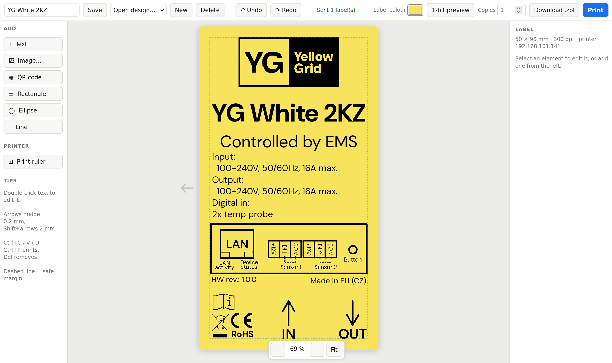

# Label printing (GoDEX G530)

A small local web app for designing product labels and printing them on a **GoDEX G530** thermal printer over the network.

You lay the label out in the browser in a drag-and-drop editor, a little like Canva. Add text, images (PNG, JPG, SVG and so on), QR codes and simple shapes, then move, resize and rotate them with the mouse. Designs are saved by name and can be reopened later. **Print** (or Ctrl+P) sends the label straight to the printer. **1-bit preview** shows exactly which dots the printer will get.

The app is set up for 90 × 50 mm label stock, designed in portrait (50 mm wide, 90 mm tall), with the company font DM Sans built in.



## How it works

```
browser editor  ──PNG──▶  Flask server  ──ZPL over TCP 9100──▶  GoDEX G530
(Fabric.js, 1 px = 1 dot)  (rotate, offsets, 1-bit)            (prints one bitmap)
```

1. **The browser draws the whole label.** The editor canvas is exactly the size of the label in printer dots (300 dpi, so 591 × 1063 px). Fonts, Czech diacritics, images and QR codes are all drawn there, so what you see is what prints. Images are turned into black and white in the editor: *threshold* mode suits logos and line art, *dither* mode suits photos and gradients.
2. **On Print, the browser sends the finished label as one PNG** to the local server (`app.py`).
3. **The server turns it into ZPL** (`label.py`). It rotates the portrait design to the way the stock runs through the printer, applies the calibration offsets from `config.toml`, and makes it strictly 1-bit. The whole label then becomes a single ZPL graphic field (`^GFA`).
4. **The ZPL job goes to the printer's raw port 9100.** It uses only basic commands (`^XA ^PW ^LL ^LH ^FO ^GFA ^PQ ^XZ`), which the G530's ZPL emulation handles reliably. The job is exactly as wide as the label, and the printer centres it on the label itself.

Because the printer only ever receives a finished bitmap, nothing depends on its built-in fonts, code pages or barcode support.

## Setup: from cloning to the first print

### 1. What you need

- A computer on the same network as the printer, running Linux, macOS or Windows.
- [uv](https://docs.astral.sh/uv/getting-started/installation/), the Python package manager. It installs the right Python (3.12+) and the dependencies (Flask, Pillow, qrcode) by itself.
- A current browser. It's tested in Chromium/Chrome; Firefox should work too.
- The GoDEX G530 connected by Ethernet, with 90 × 50 mm labels loaded.

### 2. Get the code and start the app

```sh
git clone git@github.com:Huml-YG/lable-printing-zpl.git
cd lable-printing-zpl
uv run app.py
```

**On NixOS,** run `nix-shell` first, and then `uv run app.py` inside it. `shell.nix` provides uv plus the system libraries that Pillow needs.

Open <http://127.0.0.1:5000>. The editor should appear with an empty label. The first `uv run` downloads the dependencies, which takes a moment.

### 3. Prepare the printer

1. **Find its IP address.** It's on the printer's configuration printout or self-test page, or in GoDEX's NetSetting tool. A fixed address, or a DHCP reservation, saves trouble later.
2. **Make sure it accepts ZPL.** In GoDEX GoLabel or NetSetting, set the command language (emulation) to **Auto** or **ZPL**. If labels come out with ZPL code printed as text, or nothing prints at all, this is the cause.
3. **Run media calibration** after loading the label roll, using the printer's feed button or GoLabel. This lets the printer find the gaps between labels. Skip it and the printer may feed several labels per job or stop in the middle of one.

### 4. Point the app at the printer

Open `config.toml` and set the printer's address:

```toml
[printer]
host = "192.168.101.141"
```

`config.toml` is re-read on every request, so changes apply without restarting the app. Settings the editor uses (margin, dot gain) need a browser reload.

If your stock is not 90 × 50 mm or runs through the printer differently, also adjust `stock_width_mm`, `stock_height_mm` and `rotate` in `[label]`. The comments in the file explain each value.

### 5. Calibrate the position

Every printer and roll sits slightly differently, so the print has to be lined up once.

1. In the editor, click **Print ruler** (left panel). It prints a millimetre scale over the label area, placed by the printer exactly like a real label but without any offsets applied.
2. Look at where the ruler's 0 marks land compared with the label edges, and set the offsets in `config.toml`:
   - `shift_down_mm`: moves the whole print down. Negative values move it up.
   - `shift_right_mm`: moves it right. Negative values move it left.

   Directions are as you read the finished, portrait label. With `rotate = 270`, the ruler's **x** axis runs down the label from the top, and its **y** axis runs across it from the right edge. For example, if x = 0 sits 3 mm inside the top edge, set `shift_down_mm = -3`.
3. Check with a real label. Draw a thin rectangle exactly on the dashed safe-margin line (3 mm), print it, and measure the gap to each edge. If the top and bottom gaps differ, shift by half the difference, and do the same for left and right.

The grey arrow beside the canvas shows which edge of the label leaves the printer first. If it's wrong for your setup (it shouldn't be on a G530), set `feed_flip = true` in `[label]`.

### 6. First real print

1. Add some text, an image and a QR code. Click **1-bit preview** to see the exact dots.
2. Set **Copies** and click **Print**. The status line in the top bar says *Sent 1 label(s).*, or shows the error, for example when the printer can't be reached.
3. Type a name and click **Save**. The design is stored in `designs/<name>.json` and can be reopened from **Open design…**.

### 7. Optional: tune photos and gradients

Thermal dots spread a little into their neighbours (dot gain), so dithered images print much darker than the raw bitmap suggests. Three settings in `[printer]` handle this. They are already tuned for the G530 with the current stock:

| Setting | What it does |
|---|---|
| `dither_gamma` | Lightens dithered images before they're sent to the printer. Smaller is lighter, 1 is off. Tune it until a gradient at the default **Darkness 50 %** prints well. |
| `dither_preview_gamma` | Makes the editor show dithered images as dark as they come out on paper. Screen only. |
| `dither_preview_slider` | How strongly the Darkness slider changes the on-screen look compared with the plain dither. Screen only; it matches the slider's effect on paper. |

To retune, print a black-to-transparent gradient at 25 %, 50 % and 75 % darkness and compare it with the screen. **1-bit preview** always shows the real, lightened bitmap, so it looks thinner than the print. Threshold-mode images aren't affected by any of these.

## Using the editor

- **Add** (left panel): Text, Image…, QR code, Rectangle, Ellipse, Line. Images keep their original, so resizing re-converts them sharply. SVGs stay vector until they're printed.
- **Properties** (right panel): exact position and size in mm, rotation, font, size in points, weight, alignment and spacing. For images: threshold or dither mode, invert, and Darkness. For QR codes: content and error correction. Also centring, layer order, duplicate, lock and delete.
- **Label colour** (top bar): previews coloured label stock. It's only for the screen, since the printer prints black only. It's saved with the design.
- **Panels**: drag the edges of the side panels to resize them; double-click an edge to reset it.
- **Shortcuts**:
  - Ctrl+P prints.
  - Ctrl+Z undoes; Ctrl+Y or Ctrl+Shift+Z redoes.
  - Ctrl+C and Ctrl+V copy and paste; Ctrl+D duplicates.
  - Del removes the selection.
  - Arrow keys nudge it 0.2 mm, Shift+arrows 2 mm.
  - Ctrl+scroll zooms.
- The dashed line is the 3 mm safe margin. Keep content inside it.

## Limitations

- **Black only.** The printer has one colour. Grey and colour are reproduced by dithering, and fine detail in photos is limited by 300 dpi and dot gain. Label colour is a screen preview only.
- **No variable data.** Every copy of a job is identical: no serial numbers, batch or date fields, CSV import or database. For a different batch number, edit the text and print again.
- **QR codes only.** There are no 1D barcodes (EAN, Code 128, etc.) yet.
- **Top edge.** With the current calibration the printer can't reach the top ~2 mm of the label. Stay inside the safe margin.
- **One printer, one label size** at a time, both set in `config.toml`. Tested only on the GoDEX G530 (300 dpi) with 90 × 50 mm stock.
- **No print confirmation.** "Sent" only means the job reached the printer. The app can't detect paper-out, a jam or an open lid; the printer's own lights and display show those.
- **Every job sends the whole label as a bitmap,** about 160 kB of ZPL. That's quick on a local network. Multiple copies go in one job (`^PQ`), so the bitmap isn't re-sent per copy. Nothing is stored in the printer's memory.
- **Local and single-user.** The server listens on 127.0.0.1 only, with no login. Designs are plain files in `designs/`. Two people saving the same name overwrite each other, and designs with large embedded images make large files.
- **Fonts:** only fonts in `assets/fonts/` are offered. To add one, put a `.ttf` or `.otf` file there and check its licence.
- **Calibration is per printer and per roll type.** A different printer, a reinstalled roll or another stock may need the ruler and offsets again. Very different stock may need the dot gain settings retuned.

## Files

| Path | What it is |
|---|---|
| `app.py` | Flask server: editor page, design storage, printing endpoints |
| `label.py` | PNG → 1-bit → ZPL conversion, calibration ruler, network send |
| `templates/editor.html` | The whole editor (HTML, CSS, JavaScript) |
| `config.toml` | Printer address, label size, rotation, offsets, margin, dot gain |
| `designs/` | Saved designs, one JSON file each, with images embedded |
| `assets/fonts/` | Fonts offered in the editor. `DMSans.ttf` (variable weight) and its licence `OFL.txt`, which must stay alongside it |
| `static/vendor/` | Fabric.js 5.3.0, the canvas library, bundled so the app works offline |
| `shell.nix` | NixOS dev shell (uv + libraries Pillow needs) |
